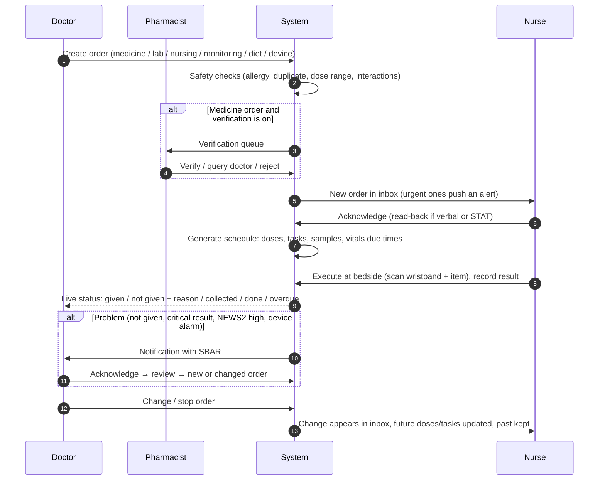

# Doctor orders, nurse carries out: Nursing module build spec

**For:** Claude Code (and the developers and testers working with it)
**Reference screens:** `reference/` (3 exported design mockups, see section 3)
**Goal:** one closed loop. The doctor prescribes or orders; the pharmacist checks medicines; the nurse sees it, does it at the bedside and records it; the doctor sees what was done, what was not, and why. Nothing gets lost between the two sides.

---

## 0. Prompt to paste into Claude Code

Copy this folder into the application repository as `docs/nursing-integration/`, open Claude Code at the repository root, and paste:

```text
Read docs/nursing-integration/NURSING_INTEGRATION_SPEC.md in full.
Then open the three reference screens in docs/nursing-integration/reference/
(each folder has a README.md; the *.dc.html file is the design: markup with
inline styles is the layout, the class inside <script type="text/x-dc"> is
the behaviour and sample data). Treat them as design references, not code to copy.

Task: build the integrated doctor-order → nurse-execution loop and the three
nursing screens described in the spec, inside this application.

Step 1 – Discover. Explore the repo and write docs/nursing-integration/PLAN.md:
  - stack, modules, routing, state, API layer, DB, messaging, auth/roles, i18n
  - which existing entities and screens already cover parts of the spec
    (patients, admissions, beds, doctor orders/prescriptions, pharmacy, lab,
    vitals, nursing notes, billing) and how you will reuse or extend them
  - the gaps, the new tables/collections, endpoints and events you will add
  - the order of work, mapped to the sprints in section 10
  Stop and show me PLAN.md before writing code.

Step 2 – Build sprint by sprint (section 10). For every user story you finish:
  - meet each acceptance criterion and write an automated test for it
  - keep the safety rules in section 7 exactly; they are not optional
  - drive department differences from configuration, never hard-coded names
  - use the app's design system; match the reference layouts and states

Do not invent clinical scoring charts, dose ranges or accreditation clause
numbers. Put them behind configuration with a TODO where the hospital must
supply them.
```

---

## 1. Scope

### In scope
| Area | What gets built |
|---|---|
| **Doctor side** | Order entry for medicines, lab and radiology, nursing orders, monitoring frequency, diet, devices and oxygen; STAT/urgent flags; verbal orders with countersign; the doctor's live view of nursing execution |
| **Pharmacy** | Verification of medicine orders before the nurse can give them (configurable on or off per hospital) |
| **Nurse side** | Order inbox and acknowledgement, MAR and barcode administration, sample collection, tasks, vitals and escalation, assessments, notes and handover, devices; three screens from `reference/` |
| **Loop back** | Every nurse action updates the doctor's view in real time; not-given doses, critical results and escalations notify the doctor |
| **Cross-cutting** | Roles and permissions, audit trail, 10-second undo, "recorded in error", offline round, languages, empty/loading/error states |

### Out of scope (for now)
Billing rules beyond posting device time and consumables, pharmacy stock, the doctor's full EMR, theatre scheduling, and the patient app.

### Users
| Role | Main jobs |
|---|---|
| Consultant / resident doctor | Orders, reviews, responds to escalations and critical results, countersigns verbal orders |
| Pharmacist | Verifies medicine orders, flags interactions and allergies |
| Staff nurse | Acknowledges orders, gives medicines, collects samples, does tasks, rounds, records, hands over |
| Nurse in-charge | Everything a nurse does + ward overview, workload, overrides review |
| Second nurse | Witnesses high-alert medicines with PIN |
| Quality / admin | Configuration, compliance reports, audit |

---

## 2. The closed loop



### 2.1 Order types and what the nurse does with them
| Order type | Doctor enters | Generated for the nurse | Nurse completes by | Doctor sees |
|---|---|---|---|---|
| **Scheduled medicine** | Drug, dose, route, frequency, start, duration, indication | Dose events on the MAR at each time | Scan wristband + medicine → Given, or Not given + reason | Each dose: given (time, by, witness), late, not given + reason |
| **PRN medicine** | Drug, dose, route, min interval, max per 24 h, indication | PRN line on the MAR (no schedule) | Give with reason + reassessment task (e.g. pain after 60 min) | Every PRN dose with reason and effect |
| **STAT / once** | Drug, dose, route, "now" | One dose due now, urgent alert | Give within the STAT window (configurable, e.g. 15 min) | Time from order to dose |
| **Infusion** | Fluid/drug, volume, rate or titration rule, duration | Start task, hourly site/rate checks, stop time | Start (scan), rate changes, stop, volume infused | Running state, rate history, volume |
| **Lab / radiology** | Test, priority, specimen, clinical note | Specimen to collect with tube type and label, or patient preparation | Collect (scan wristband + label) → send → result | Collected, sent, resulted; critical value read-back |
| **Nursing order** | Free text or template (dressing, turning, catheter care, physio) + frequency | Tasks at the right times | Mark done / not done + reason | Done or overdue |
| **Monitoring order** | Vitals frequency, parameters, alert limits, target ranges (e.g. SpO₂ 88–92%) | Vitals due times, limits on the chart | Record vitals; out-of-range triggers escalation | Chart with limits, escalations |
| **Diet / fluids** | Diet type, NBM from–to, fluid restriction | Diet on the band, intake/output targets | Record intake/output | Balance |
| **Device / oxygen** | Device, settings, duration | Start task, checks while running | Start, check, stop (time goes to billing) | Device running, settings, time |
| **Verbal / telephone order** | Nurse enters on behalf of the doctor | Same as the order type | Read-back recorded at entry | Countersign task in the doctor's inbox within the set time |

### 2.2 Order life cycle (state machine)
```
draft ─► signed ─► (pharmacy: pending_verification ─► verified | queried | rejected)
                 └► active ─► acknowledged_by_nurse ─► in_progress ─► completed
                                                     ├► on_hold (doctor) ─► active
                                                     ├► changed  → new version, old version kept
                                                     └► stopped / cancelled (reason, by, time)
```
- A medicine order is **not givable** until it is verified (when verification is on). Exception: STAT and emergency orders can be given first and verified after, flagged for pharmacist review.
- Changing an order creates a **new version**; doses already given stay attached to the version they were given under.
- Stopping an order cancels **future** doses and tasks only; nothing past is deleted.

### 2.3 Dose / task life cycle
```
scheduled ─► due (window opens) ─► overdue (window closed, not recorded)
     │            │
     │            ├► given (scan | override+reason) ─► [10 s undo] ─► final
     │            ├► not_given (refused | held by doctor | NBM | patient away | unavailable | other) ─► doctor notified
     │            └► recorded_in_error (keeps original, reason, by, time) ─► becomes due/overdue again
     └► cancelled (order stopped or changed)
```
Window defaults (configurable): due from 30 min before to 30 min after scheduled time; STAT within 15 min; time-critical medicines (e.g. insulin, antibiotics, anti-epileptics) flagged separately.

### 2.4 Notifications back to the doctor
| Event | Who | How fast |
|---|---|---|
| Dose not given (any reason) | Ordering doctor | Inbox, same shift |
| Time-critical dose overdue | Ordering doctor + in-charge | Push now |
| Critical lab value | Ordering doctor | Push now; closes when nurse records read-back |
| NEWS2 / score escalation | Doctor on call for the ward | Push now; open → acknowledged → reviewed |
| Verbal order needs countersign | Ordering doctor | Inbox, within configured hours |
| Device alarm / stopped early | Ordering doctor | Inbox |
| Nurse message (SBAR) | Chosen doctor | Push; shows sent / seen / acknowledged |

---

## 3. Reference screens (in `reference/`)

Open each folder with a static server (`python3 -m http.server`) and load the `.dc.html` file. Replicate the layout, spacing, states and behaviour in the app's own components.

### 3.1 `Nursing_workspace · one patient · desktop` → `Main.dc.html`
The nurse's main screen for one patient. Take from it:
- **Top bar:** shift, alerts bell with self-closing alerts, language switch (EN / Marathi / Hindi), links to round, console and workload.
- **Bed strip:** every patient of the nurse, NEWS2 and alert tags, ‹ › and ← → keys to switch, Ctrl K finder.
- **Patient band:** allergy first, flags, NEWS2 ring with escalation state (open → acknowledged → reviewed), "Message doctor" with SBAR, seen/acknowledged status.
- **Record vitals:** values auto-filled from a linked monitor with a source label per value; manual fallback; monitor-offline state.
- **Trends / Assessment (40%) + Compliance (60%):** chosen parameter chart with target band; risk scales with due state; compliance groups that fold when complete, auto items that tick from the record.
- **Shift timeline:** one hour-by-hour strip for medicines, tasks, assessments, samples, turns, device checks.
- **Medication:** day MAR; due doses open the **give flow** (scan wristband → scan medicine → system checks → high-alert second nurse + PIN → confirm; override needs reason + note); given doses can be marked **recorded in error**.
- **Nursing orders:** critical value banner with read-back; lab steppers Ordered → Collected → Sent → Resulted; general orders with Acknowledge.
- **Nurse note:** DAR / SOAP / free text, quick-insert chips, dictation, photo attach, sign with 10-second undo, recorded in error.
- **Wound and site photos**, **empty / loading / error states**, **10-second undo toast**.

### 3.2 `Nurse round · bed by bed` → `NurseRound.dc.html`
A guided round through the nurse's beds:
- Progress across beds, pause round, previous/next bed.
- **"Check at this bed"** list pulled from the medicine chart, orders and assessment due times.
- **Round checklist** grouped (pain, position, lines/devices/skin, comfort and needs, safety) with "All normal" one-tap and per-item act/follow-up.
- Quick vitals (optional, shown when due), one-line round note.
- **Patient not available** → "come back by" reminder within 30 min.
- **Round summary** saved to each patient and the ward rounding log.

### 3.3 `My console · drag, resize, choose parameters` → `MyConsole.dc.html`
The nurse's personal layout:
- Sections can be **dragged, resized, hidden, added from a library**; saved per user; the ward default stays.
- **Parameters:** choose what to monitor for this patient; alert limits come from the ward default or the doctor's monitoring order, and can be changed per patient (logged).
- Sections: medicines due, nursing orders, tasks, risk assessments, compliance ring, notes, **intake and output** running balance, **lines, drains and devices**, **devices with live timers** (start with settings, nursing checks while running, stop with reason, today's sessions and total time **posted to the IPD bill**), SBAR handover built from the record.

---

## 4. Epics and user stories

Priority: **MVP** = needed for the loop to work safely; **Next** = second release; **Later**.
Each story's acceptance criteria are written as Given / When / Then. IDs are referenced in tests and in `user-stories.csv`.

### Epic A: Doctor order entry
**A1 (MVP)** As a doctor, I want to prescribe a scheduled medicine with dose, route, frequency, start and duration, so that the nurse gets an exact schedule.
- Given an admitted patient, when I sign a medicine order, then dose events are created for every scheduled time within the duration, and the order appears in the nurse's inbox as **New**.
- Given the patient has a recorded allergy that matches the drug or its class, when I try to sign, then I see a hard stop with the allergy and must enter an override reason to continue.
- Given an identical active order exists, when I sign, then I see a duplicate warning.

**A2 (MVP)** As a doctor, I want to mark an order STAT or urgent, so that the nurse is alerted at once.
- When I sign a STAT order, then the assigned nurse and in-charge get a push alert, and the dose is due now with the STAT window (default 15 min) shown as a countdown.

**A3 (MVP)** As a doctor, I want to order PRN medicines with an indication, minimum interval and 24-hour maximum.
- Given a PRN dose was given less than the minimum interval ago, when the nurse tries to give again, then the give flow blocks with the time it becomes allowed.
- When the 24-hour maximum is reached, then the PRN line is locked until the window allows another dose.

**A4 (MVP)** As a doctor, I want to order lab and radiology tests with priority and a clinical note, so that the nurse knows what to collect or prepare.
- When I sign a lab order, then a specimen task appears with tube type, volume and label, due by priority (STAT now, urgent 1 h, routine next round, configurable).

**A5 (MVP)** As a doctor, I want to write nursing orders (dressing, turning, catheter care, physiotherapy) with a frequency, so that they become timed tasks.

**A6 (MVP)** As a doctor, I want to set the monitoring order: vitals frequency, alert limits and target ranges for this patient.
- When I set SpO₂ target 88–92% for a COPD patient, then the nurse's chart, trend band and escalation rules use that target for this patient only.

**A7 (Next)** As a doctor, I want to order infusions with rate or a titration rule, so that the nurse can start, adjust and stop them correctly.

**A8 (Next)** As a doctor, I want to order diet, nil-by-mouth windows and fluid restrictions.
- During an NBM window, oral medicines show a "patient is nil by mouth" warning in the give flow.

**A9 (Next)** As a doctor, I want to order devices and oxygen with settings and duration, so that the nurse's device timer and checks follow my order.

**A10 (MVP)** As a doctor, I want to change, hold or stop an order with a reason, so that the nurse sees the change immediately and nothing past is lost.
- When I change the dose, then a new version is created, future doses use it, past doses stay linked to the old version, and the nurse's inbox shows **Changed** with old → new.
- When I stop an order, then future doses are cancelled and shown as "stopped by Dr X at hh:mm", and doses already given are unchanged.

**A11 (MVP)** As a nurse, I want to enter a verbal or telephone order on the doctor's behalf with read-back, so that urgent care is not delayed.
- When I enter a verbal order, then I must tick "read back to the doctor", it is labelled **Verbal**, and the doctor gets a countersign task; if not countersigned within the configured hours, the in-charge is alerted.

### Epic B: Pharmacist verification
**B1 (MVP, configurable)** As a pharmacist, I want new medicine orders in a queue with allergies, interactions, renal/weight dosing and duplicates shown, so that I can verify, query or reject.
- Given verification is on, when an order is waiting, then the nurse sees it on the MAR as "Waiting for pharmacist" and cannot give it (except STAT/emergency, see B2).
- When I query the doctor, then the doctor gets the query and the order stays not givable until resolved.

**B2 (MVP)** As a nurse, I want to give a STAT or emergency medicine before verification, so that urgent treatment is not delayed.
- The dose is recorded with "given before pharmacist check" and the pharmacist gets a retrospective review task.

### Epic C: Nurse order inbox
**C1 (MVP)** As a nurse, I want one inbox of new, changed and stopped orders for my patients, so that I don't miss any change.
- Each item shows patient, order, who, when, and what changed; I acknowledge with one tap; unacknowledged orders older than the configured time alert the in-charge.
- The tab or bed tile shows a count badge; STAT items are red, others amber.

**C2 (MVP)** As a nurse, I want acknowledging an order to create my work automatically (doses, samples, tasks, monitoring times), so that I don't re-enter anything.

### Epic D: Medicine administration (MAR + barcode)
**D1 (MVP)** As a nurse, I want a day MAR showing every dose as scheduled, due, overdue, given, not given or recorded in error, so that I see the whole day at a glance.
- Due and overdue doses come first; medicines with nothing due fold behind "Show n".

**D2 (MVP)** As a nurse, I want to give a medicine by scanning the patient's wristband and then the medicine, so that the five rights are checked by the system.
- Given I scan another patient's wristband, then I see a red STOP naming that patient and Confirm stays disabled.
- Given I scan a medicine that is not due for this patient, then I see STOP with the scanned item and Confirm stays disabled.
- When both scans match, then the system shows checks for patient, drug, dose, route, time (late shows minutes), allergy, last-given interval and weight-based dose where configured.

**D3 (MVP)** As a nurse, I want high-alert medicines to require a second nurse, so that errors are caught before the dose.
- Confirm is disabled until a second nurse is chosen and their PIN is verified by the server.

**D4 (MVP)** As a nurse, I want a manual override when scanning is impossible, with a reason and what I checked instead.
- Reasons: wristband damaged or missing, medicine has no barcode, scanner not working, emergency; note at least 4 characters. Overrides go to a pharmacy/quality report and untick "every dose scanned" in compliance.

**D5 (MVP)** As a nurse, I want to record "not given" with a reason, so that the doctor knows and can act.
- Reasons: patient refused, held by doctor, nil by mouth, patient away, medicine unavailable, vomited, other. The ordering doctor is notified (section 2.4).

**D6 (MVP)** As a nurse, I want 10 seconds to undo a "Given", and after that a "recorded in error" path that keeps the original.
- Undo restores the exact previous state; after 10 s, "recorded in error" asks a reason (not given, wrong patient, wrong time, duplicate), keeps the entry visible struck through with who/when/why, and the dose becomes due or overdue again.

**D7 (Next)** As a nurse, I want to give PRN doses with a reason and get a reassessment task, so that the effect is recorded.

**D8 (Next)** As a nurse, I want to start, change the rate of, and stop infusions with scanning, so that the doctor sees rate history and volume.

### Epic E: Samples, results and critical values
**E1 (MVP)** As a nurse, I want to collect a sample by scanning the wristband and the printed label, so that the right specimen goes to the lab.
- Steps Ordered → Collected → Sent → Resulted, each with time and user; Collect can be undone for 10 s.

**E2 (MVP)** As a nurse, I want a critical value banner and a read-back form, so that the doctor is told and it is documented.
- When I record the doctor's name, "read back" tick and instruction, then the critical alert closes everywhere at once (bell, bed tile, orders badge, compliance) and the doctor's view shows the read-back.

### Epic F: Vitals, monitoring and escalation
**F1 (MVP)** As a nurse, I want vitals due times to follow the doctor's monitoring order, so that I check as often as ordered.

**F2 (MVP)** As a nurse, I want linked monitors to fill pulse, BP, respiratory rate and SpO₂, with each value labelled by source, so that I only check and save.
- If the monitor stops sending, the device fields empty and say since when; manual entry is offered.

**F3 (MVP)** As a nurse, I want the warning score worked out on save and escalation raised when it crosses the threshold, so that the doctor is called in time.
- The score tool follows the **patient**: adult → NEWS2; pregnant → obstetric score; under 16 → paediatric score; newborn → newborn score. Only NEWS2 is calculated in MVP; the others are configurable stubs (TODO for the hospital's chart).
- Escalation states: open → acknowledged (doctor replies) → reviewed (doctor documents review). Nobody closes it by hand.

**F4 (MVP)** As a nurse, I want to message the doctor with an SBAR filled from the record and see sent / seen / acknowledged.
- A doctor's acknowledgement also moves the escalation to acknowledged.

### Epic G: Tasks, assessments and the shift timeline
**G1 (MVP)** As a nurse, I want one hour-by-hour timeline for my shift with medicines, tasks, assessments, samples, turns and device checks, so that I plan my time.
- Overdue = red, due this hour = amber, done/later = grey; tapping an item acts on it (medicines open the give flow).

**G2 (MVP)** As a nurse, I want risk assessments (fall, pressure, pain, IV site) with due times from policy, so that I reassess on time.

**G3 (Next)** As a nurse in a stage-based area (emergency, labour, dialysis, day care), I want a stage pathway instead of an hourly grid. (Configured per department.)

### Epic H: Nurse round (reference 3.2)
**H1 (MVP)** As a nurse, I want a guided round bed by bed with a checklist and the items due at each bed, so that nothing is missed.
- "All normal" ticks the checklist in one tap; any item marked "act" creates a follow-up task.
- "Patient not available" marks the bed and reminds me to come back within 30 minutes.
- On finish, a round summary is saved to each patient and to the ward rounding log.

**H2 (Next)** As a nurse, I want to do the round on a phone offline, so that a weak network doesn't stop me; entries sync when the network returns, and conflicts are shown, not overwritten.

### Epic I: My console (reference 3.3)
**I1 (Next)** As a nurse, I want to arrange my console (drag, resize, hide, add sections), saved for me only, so that it fits how I work.

**I2 (Next)** As a nurse, I want to choose which parameters to monitor for a patient and adjust alert limits within what the doctor ordered, logged with my name.

**I3 (Next)** As a nurse, I want to start and stop devices with live timers, required checks while running, and a stop reason, so that use is safe and the time reaches the bill.
- Device time per session and per day is posted to the IPD bill using the device's billing unit (per hour / per day).

**I4 (Next)** As a nurse, I want a running intake/output balance since the start of the shift.

### Epic J: Notes and handover
**J1 (MVP)** As a nurse, I want to write DAR, SOAP or free-text notes with quick-insert chips and dictation, and sign them, so that documentation is fast.
- Signed notes are locked; 10-second undo returns the text to the editor; after that, corrections are addenda or "recorded in error" (kept, struck through).

**J2 (MVP)** As a nurse, I want an SBAR handover built from the record for each patient, which the receiving nurse accepts.

**J3 (Next)** As a nurse, I want to attach wound and site photos to an assessment or note.

### Epic K: The doctor's view of nursing (closing the loop)
**K1 (MVP)** As a doctor, I want each order to show its live nursing status (acknowledged, next due, last given, not given + reason, overdue), so that I know my orders are being carried out.

**K2 (MVP)** As a doctor, I want an inbox of things that need me: escalations, critical results, not-given doses, verbal orders to countersign, pharmacist queries, nurse messages.
- Each item opens the patient with the relevant order or chart; acting on it (acknowledge, review, countersign, reply) closes it for both sides.

**K3 (Next)** As a doctor, I want a compact MAR and vitals chart on my patient screen, read-only, with the nurse's notes since my last review.

### Epic L: Ward management, compliance and audit
**L1 (Next)** As a nurse in-charge, I want a workload view with patients per nurse weighted by acuity and a suggestion to rebalance.
**L2 (MVP)** As quality, I want every action audit-logged (who, what, when, device, before/after) and reports for overrides, not-given doses, late time-critical doses, unacknowledged orders and escalation response times.
**L3 (Next)** As quality, I want compliance items mapped at chapter level to NABH/JCI, configurable per department, without clause numbers in the product.

### Epic M: Cross-cutting
**M1 (MVP)** Department profiles (list type, timeline type, vital set, scales, bundles, devices, round frequency) are configuration.
**M2 (MVP)** Empty, loading and error states for every panel (what happened, what is still safe, next step).
**M3 (Next)** Labels in English, Marathi and Hindi (drug names, values, units stay English); reviewed by nursing staff.
**M4 (MVP)** Keyboard: Ctrl K patient finder; arrows switch patient when not typing; Esc closes overlays. Touch targets ≥ 44 px.

---

## 5. Data model (adapt to existing tables)

```ts
// Orders (doctor side) – versioned
interface Order { id; patientId; admissionId; type: 'medication'|'lab'|'radiology'|'nursing'|'monitoring'|'diet'|'device';
  priority: 'routine'|'urgent'|'stat'; status: 'draft'|'signed'|'pending_verification'|'verified'|'queried'|'rejected'|'active'|'on_hold'|'stopped'|'completed'|'cancelled';
  currentVersion: number; orderedBy; orderedAt; verbal?: { enteredBy; readBack: true; countersignedAt?; countersignBy? };
  ackBy?; ackAt?; stopReason?; }
interface OrderVersion { orderId; version; payload: MedicationPayload|LabPayload|NursingPayload|MonitoringPayload|DietPayload|DevicePayload; createdBy; createdAt; reason?; }
interface MedicationPayload { drugId; dose; unit; route; frequency: { kind:'scheduled'|'prn'|'once'|'infusion'; times?: string[]; minIntervalMin?; max24h?; rate?; titration? };
  start; end?; indication?; highAlert: boolean; timeCritical: boolean; weightBased?: { mgPerKg; weightKgAt } }
interface MonitoringPayload { vitals: string[]; everyMinutes; limits: Record<string,[number,number]>; targets?: Record<string,[number,number]> }

// Pharmacy
interface Verification { orderId; version; by; at; result:'verified'|'queried'|'rejected'; note?; retrospective?: boolean }

// Nurse side – generated work
interface DoseEvent { id; orderId; version; scheduledAt; windowFrom; windowTo;
  status:'scheduled'|'due'|'overdue'|'given'|'not_given'|'recorded_in_error'|'cancelled';
  method?:'scan'|'override'; overrideReason?; overrideNote?; witnessUserId?; givenBy?; givenAt?; notGivenReason?; prnReason?;
  supersedes?; errorReason?; errorBy?; errorAt?; }
interface Task { id; patientId; orderId?; kind:'nursing'|'assessment'|'vitals'|'turn'|'device_check'|'reassessment'|'countersign'|'come_back';
  dueAt; status:'open'|'done'|'not_done'|'cancelled'; doneBy?; doneAt?; reason? }
interface Specimen { id; orderId; tube; label; status:'ordered'|'collected'|'sent'|'resulted'; collectedBy?; collectedAt?; result?; critical?: { value; readBackTo?; readBackAt?; instruction? } }
interface VitalsSet { id; patientId; at; values: Record<string,{ value; source:'device'|'manual'; deviceId? }>; score?: { tool; value; band } }
interface Escalation { id; patientId; trigger:'score'|'critical_result'|'nurse_concern'|'device'; state:'open'|'acknowledged'|'reviewed'; raisedAt; ackBy?; ackAt?; reviewedBy?; reviewedAt?; plan? }
interface Message { id; patientId; from; to; text; sbar?: boolean; sentAt; seenAt?; acknowledgedAt? }
interface DeviceSession { id; patientId; orderId?; deviceType; deviceTag?; settings; startedAt; stoppedAt?; stopReason?; checks: { at; by; note }[]; billedUnits? }
interface Note { id; patientId; format:'DAR'|'SOAP'|'FREE'; body; signedBy; signedAt; photos?: string[]; addenda: { at; by; text }[]; inError?: { reason; by; at } }
interface Round { id; ward; nurse; startedAt; finishedAt?; beds: { patientId; status:'done'|'not_available'|'skipped'; checklist: Record<string,'ok'|'act'>; note?; comeBackBy? }[] }
interface ConsoleLayout { userId; wardId?; sections: { key; w; h; x; y; hidden }[]; parameters: Record<patientId,string[]> }
interface AuditEvent { id; at; userId; deviceId; entity; entityId; action; before?; after? }
```

**FHIR mapping (for HL7/FHIR interfaces):** Order(medication) → `MedicationRequest`; DoseEvent → `MedicationAdministration`; Verification → `MedicationRequest` status + `Provenance`; lab/radiology/nursing orders → `ServiceRequest`; Task → `Task`; Specimen → `Specimen`; result → `Observation`/`DiagnosticReport`; VitalsSet → `Observation` (vital-signs profile); Escalation → `Flag` + `Communication`; Message → `Communication`; DeviceSession → `DeviceUsage` (R5) / `DeviceUseStatement` (R4); Note → `DocumentReference` or `Composition`; AuditEvent → `AuditEvent`.

---

## 6. API and events (names indicative; follow the repo's conventions)

### REST
```
POST   /patients/{id}/orders                 create + sign (body: type, priority, payload, verbal?)
PATCH  /orders/{id}                          change (new version) | hold | resume | stop {reason}
POST   /orders/{id}/countersign
GET    /pharmacy/verification-queue
POST   /orders/{id}/verification             {result, note}
GET    /nurse/inbox?ward=&nurse=             new/changed/stopped orders
POST   /orders/{id}/acknowledge
GET    /patients/{id}/mar?date=
POST   /dose-events/{id}/administer          {wristbandCode, itemCode | override{reason,note}, witness{userId,pin}?}
POST   /dose-events/{id}/not-given           {reason}
POST   /dose-events/{id}/recorded-in-error   {reason}
POST   /actions/{actionId}/undo              (only within 10 s, only by the same user)
POST   /specimens/{id}/collect | /send ; POST /specimens/{id}/read-back {doctor, instruction}
POST   /patients/{id}/vitals                 {values, source per value}
POST   /escalations/{id}/acknowledge | /review
POST   /patients/{id}/messages ; POST /messages/{id}/seen | /acknowledge
POST   /tasks/{id}/done | /not-done
POST   /patients/{id}/devices ; POST /device-sessions/{id}/check | /stop
POST   /rounds ; PATCH /rounds/{id}/beds/{patientId} ; POST /rounds/{id}/finish
GET/PUT /users/me/console-layout
GET    /doctor/inbox ; GET /orders/{id}/execution-status
```

### Domain events (publish on the app's bus; push to clients over WebSocket/SSE)
`order.signed`, `order.changed`, `order.stopped`, `order.verified`, `order.queried`, `order.acknowledged`,
`dose.due`, `dose.overdue`, `dose.given`, `dose.not_given`, `dose.recorded_in_error`, `action.undone`,
`specimen.collected`, `result.critical`, `result.read_back`,
`vitals.recorded`, `escalation.raised`, `escalation.acknowledged`, `escalation.reviewed`,
`message.sent`, `message.seen`, `message.acknowledged`, `device.started`, `device.stopped`, `round.finished`.
Each event carries `patientId`, `orderId?`, `actorId`, `at`, and a minimal payload; both the doctor's and nurse's screens subscribe and update without reload.

### Scheduler
A job materialises `DoseEvent` and `Task` rows from active orders (rolling 48 h), moves `due` → `overdue` when windows close, raises time-critical alerts, and reminds about unacknowledged orders and uncountersigned verbal orders.

---

## 7. Safety rules (must not be relaxed)
1. No medicine is givable until verified, except STAT/emergency, which is flagged for retrospective pharmacist review.
2. No dose is recorded without wristband + medicine scan, or an override with reason and note.
3. High-alert medicines need a second nurse and a server-verified PIN.
4. Allergy is always visible in the patient band; "no known allergy" is an explicit recorded state, never a blank.
5. Signed records (doses, notes, assessments, results read-back) are never deleted or overwritten. Corrections are "recorded in error" or addenda with reason, user and time. Undo exists only for 10 s, only for the same user, and is itself audited.
6. Order changes create versions; past doses stay linked to the version they were given under.
7. Alerts close only through the clinical action that resolves them (doctor review, read-back, dose given or not-given recorded).
8. The warning-score tool is chosen by patient type; adult NEWS2 is never shown for pregnant women, children or newborns.
9. Device-filled vitals are labelled; stale device values are never saved.
10. Every action is audit-logged (user, time, device, before/after).

### Configurable settings (with defaults)
| Setting | Default |
|---|---|
| Pharmacist verification required | On |
| Dose window before/after scheduled time | 30 / 30 min |
| STAT window | 15 min |
| Unacknowledged order alert to in-charge | 30 min (STAT: 5 min) |
| Verbal order countersign within | 24 h |
| Undo window | 10 s |
| Vitals default frequency per department | ICU 1 h, ward 4 h |
| High-alert and time-critical drug lists | Hospital formulary |
| Escalation thresholds and response targets | Hospital policy (NEWS2 per RCP chart) |
| Score tools for pregnant / child / newborn | TODO: hospital supplies chart |

---

## 8. Screens and components to build

| Screen | Built from | Key components |
|---|---|---|
| Nursing workspace (one patient) | `reference/…one_patient…/Main.dc.html` | TopBar (alerts, language), BedStrip, PatientBand, ScoreRing+EscalationState, RecordVitalsPanel (device source), TrendChart, AssessmentList, ComplianceGroups, ShiftTimeline, MAR + GiveMedicineModal, OrdersPanel (critical banner, lab stepper, general orders), NoteEditor + NoteHistory, UndoToast, PatientFinder (Ctrl K) |
| Nurse round | `reference/…Nurse_round…/NurseRound.dc.html` | RoundHeader (progress, pause), BedCard, DueAtBedList, RoundChecklist (All normal, act), QuickVitals, RoundNote, NotAvailable, RoundSummary |
| My console | `reference/…My_console…/MyConsole.dc.html` | DraggableGrid (drag, resize, hide, library), ParameterPicker + LimitEditor, DeviceTimers (start wizard, checks, stop reason, today's use → bill), IntakeOutput, SBARHandover |
| Doctor order entry (new) | App's existing prescription/EMR screen | OrderForm per type, safety checks, STAT, verbal countersign |
| Doctor's nursing status (new) | — | Order status chips on each order, DoctorInbox, read-only MAR/vitals |
| Pharmacist queue (new) | App's pharmacy module | VerificationQueue, query/reject |

**Design tokens from the references** (use the app's tokens if they exist): primary `#0B6E69`; ink `#0B1220`; secondary text `#475467`; lines `#E2E7EF`; background `#EEF2F7`; critical `#B42318` (only for "act now"); warning `#B54708`/`#8A5300`; success `#067647`; radius 12–18 px; body font Inter, headings Space Grotesk; focus ring 3 px primary at 33% alpha; minimum touch target 44 px.

---

## 9. End-to-end scenarios (write these as integration/E2E tests)
1. **Scheduled dose:** Doctor orders Enoxaparin 40 mg SC daily 11 AM → pharmacist verifies → nurse inbox shows New → nurse acknowledges → dose due 11 AM → nurse scans wristband + medicine, second nurse PIN (high-alert) → Given → doctor's order shows "Given 11:05 by Sr. X, checked by Y".
2. **Wrong patient:** Nurse scans another patient's wristband → STOP → no record created; audit has the failed scan.
3. **Not given:** Nurse records "Patient refused" → doctor inbox gets it within the shift → doctor changes order → nurse inbox shows Changed.
4. **Undo and error:** Nurse gives a dose, presses Undo within 10 s → dose due again, audit shows give + undo. Gives again, after 15 s marks "recorded in error: wrong time" → original visible struck through, dose due again.
5. **Critical result:** Lab posts K⁺ 2.9 critical → red banner + bell + doctor push → nurse records read-back with instruction → alert closes on both sides → doctor orders KCl → appears in nurse inbox.
6. **Escalation:** Nurse saves vitals giving NEWS2 7 → escalation open, doctor paged → nurse sends SBAR message → doctor acknowledges (message + escalation acknowledged) → doctor documents review → escalation reviewed, cleared everywhere.
7. **Verbal order:** Nurse enters verbal STAT order with read-back → dose given before verification (flagged) → pharmacist retrospective review task → doctor countersign task; overdue countersign alerts in-charge.
8. **Stop order:** Doctor stops antibiotic at 2 PM → 8 PM dose cancelled with "stopped by Dr X"; 8 AM given dose unchanged.
9. **Round:** Nurse starts round, marks bed 3 "not available" → come-back task in 30 min → finishes round → summary in each patient record and ward log.
10. **Device:** Nurse starts BiPAP with settings → checks due while running → stops with reason after 2 h 10 min → 2.17 h posted to the IPD bill at the per-hour rate.
11. **Offline round:** Network drops mid-round → entries queue with count → network returns → entries sync; a conflicting change by another nurse is shown for choice, not overwritten.

---

## 10. Build plan

| Sprint | Stories | Done when |
|---|---|---|
| **0. Discover** | — | PLAN.md approved: reuse map, schema changes, events, risks |
| **1. Order core** | A1, A2, A10, B1, C1, C2, L2 (audit), M1 | Doctor signs medicine order → pharmacist verifies → nurse inbox → acknowledge creates dose events; versions and stop work; audit on all |
| **2. Administration** | D1–D6, A3, B2, F1 | Give flow with scan, high-alert witness, override, not given, undo, recorded in error; scheduler moves due → overdue; doctor sees dose status (K1 partial) |
| **3. Loop back to doctor** | K1, K2, F2–F4, E1, E2, A4, A6 | Doctor inbox; escalation states; critical read-back; samples; monitoring orders drive vitals and limits; messages seen/ack |
| **4. Nursing workspace screen** | G1, G2, J1, J2, A5, A11, M2, M4 | Main.dc.html layout complete with all states; timeline; notes; handover; verbal orders |
| **5. Round** | H1, (H2 if phones are in scope) | NurseRound flow end to end; round log |
| **6. Console and devices** | I1–I4, A7, A8, A9, D7, D8 | MyConsole layout persistence, parameters, device timers to billing, infusions, PRN, diet |
| **7. Hardening** | L1, L3, M3, G3, J3, K3 | Workload, compliance mapping, languages, stage pathway, photos, doctor read-only charts; performance and security review |

**Definition of done (every story):** acceptance criteria pass as automated tests; audit events written; permissions enforced on the server (not just hidden in the UI); empty/loading/error states present; keyboard and 44 px targets; no hard-coded department names; reviewed against section 7.

---

## 11. Open decisions for the hospital
- Is pharmacist verification on for all wards, or off for some (e.g. day care)?
- Exact dose windows, STAT window, time-critical drug list, high-alert list.
- Score charts for pregnant, paediatric and newborn patients and their escalation thresholds.
- Which monitors, pumps and dialysis machines can send data, and through which interface (HL7 v2, FHIR, vendor gateway).
- Device billing units and rates.
- Who can change alert limits set by a doctor (nurse within a band, or doctor only).
- Final Marathi and Hindi wording.

## 12. Files in this package
| Path | What |
|---|---|
| `NURSING_INTEGRATION_SPEC.md` | This spec |
| `user-stories.csv` | All user stories with epic, priority, sprint and acceptance criteria, for import into Jira or Azure Boards |
| `reference/Nursing_workspace_one_patient/` | `Main.dc.html` + runtime: nursing workspace design |
| `reference/Nurse_round_bed_by_bed/` | `NurseRound.dc.html` + runtime: guided round design |
| `reference/My_console/` | `MyConsole.dc.html` + runtime: personal console and devices design |
